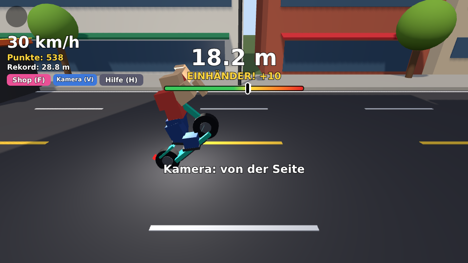
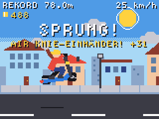
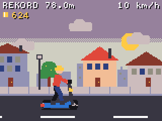
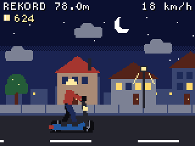
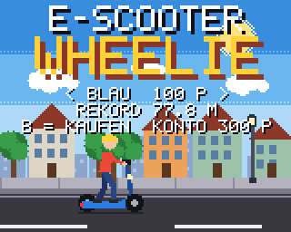

# E-Scooter Wheelie 🛴

Ein Wheelie-Spiel für den **Adafruit PyBadge** und **PyBadge LC**.

> **Neu: das Spiel gibt es jetzt auch für Roblox!** Als 3D-Spiel mit Rampen,
> Tricks, Blitzern und Farben-Shop, zusammen mit Freunden spielbar, auch auf
> dem Handy. Alles dazu steht in [`roblox/`](roblox/README.md).
>
> 

Die aktuelle Version ist ein **MakeCode-Arcade-Spiel**: Sie wird in echte
Maschinensprache übersetzt und läuft deshalb viel flüssiger als die erste
Version in CircuitPython (die liegt noch im Ordner [`circuitpython/`](circuitpython/)).


| Start | Wheelie | Trick-Combo | Sprung |
|---|---|---|---|
|  |  |  |  |

| Burnout | Abendrot | Nacht | Farben-Shop |
|---|---|---|---|
|  |  |  |  |

*(Bilder aus dem MakeCode-Simulator.)*

## Installation (geht auch nur mit dem Handy)

Du brauchst den PyBadge und ein **USB-Kabel, das Daten überträgt**.

1. Lade die Datei [`wheelie.uf2`](wheelie.uf2) herunter
   (auf GitHub: Datei öffnen → „Download raw file“).
2. Steck den PyBadge an (Computer oder Handy mit USB-Adapter) und schalte ihn
   auf **ON**.
3. Drück auf der **Rückseite zweimal schnell** den **Reset-Knopf**. Die LED
   leuchtet grün und es erscheint ein Laufwerk **BADGELCBOOT**
   (beim großen PyBadge: **PYBADGEBOOT**).
4. Kopiere `wheelie.uf2` auf dieses Laufwerk. Der PyBadge startet neu und das
   Spiel läuft. Ab jetzt startet es bei jedem Einschalten von selbst.

Das war's, es ist nur diese **eine Datei**. Rekorde, Punkte und gekaufte
Farben werden im PyBadge gespeichert.

## Steuerung

| Knopf | Funktion |
|---|---|
| **OBEN** | Wheelie-Mode an: das Vorderrad geht hoch |
| **OBEN** nochmal | sauber landen: der Wheelie wird gezählt |
| **A** | Gas (bis 100 km/h), im Wheelie: Vorderrad höher |
| **B** | Bremse, im Wheelie: Vorderrad runter |
| **A + B** halten | Burnout! Danach nur B loslassen = Turbo-Start |
| **LINKS** halten | Trick: Einhänder |
| **RECHTS** halten | Trick: No-Hander |
| **RUNTER** halten | Trick: in die Knie |
| **MENU** (START) | Pause-Menü: Lautstärke, Helligkeit, FPS-Anzeige, Rekorde löschen |
| **LINKS / RECHTS** im Startbildschirm | Scooter-Farbe aussuchen |
| **B** im Startbildschirm | Farbe mit Punkten kaufen |

## So geht das Spiel

* Der Scooter rollt von allein mit 25 km/h. Mit **A** gibst du Gas.
* Drück **OBEN** für den **Wheelie-Mode** und halte dann mit **A** (höher)
  und **B** (tiefer) die Balance. Die Anzeige oben hilft: grün = sicher,
  gelb = Balance, rot = gleich kippst du um.
* Mit nochmal **OBEN** landest du sauber, dann zählt die Strecke. Kippst du
  nach hinten um, zählt der Wheelie nicht.
* **Rekord-Fahne:** Im Wheelie steht am Straßenrand eine rote Fahne. Schaffst
  du es bis dorthin, ist es ein neuer Rekord.
* **Tricks** (LINKS, RECHTS, RUNTER, auch kombiniert) geben Trick-Punkte.
  Zeigst du im gleichen Wheelie mehrere verschiedene Tricks, gibt es eine
  **Combo** (x2, x3 …) und die Punkte zählen mehrfach.
* **Rampen:** Drüberfahren = Sprung. In der Luft gibt es Sprung-Punkte, mit
  Tricks mehr. Aber: Wer mit No-Hander landet, stürzt.
* **Münzen** geben je 10 Punkte. Manche hängen so hoch, dass du sie nur im
  Wheelie oder im Sprung erwischst.
* **Blitzer:** Fährst du mit mehr als 60 km/h vorbei, wirst du geblitzt und
  bekommst so viele Punkte, wie du km/h draufhattest.
* **Gullydeckel** schütteln dich im Wheelie durch.
* **Tag und Nacht:** Die Sonne geht unter, die Fenster und Laternen gehen an.
* **Farben-Shop:** Alle Punkte landen auf deinem Konto. Im Startbildschirm
  kaufst du damit neue Scooter-Farben:

  | Mint | Blau | Pink | Neon | Feuer-Rot | Schwarz | Gold | Regenbogen |
  |---|---|---|---|---|---|---|---|
  | gratis | 100 | 250 | 500 | 750 | 1000 | 2000 | 5000 |

* Die **LED** unter dem Display zeigt im Wheelie grün → gelb → rot.

## Zurück zur alten CircuitPython-Version

Die alte Version liegt in [`circuitpython/`](circuitpython/README.md).
Dafür wieder CircuitPython installieren und `code.py` + `grafik.py`
kopieren. Die Rekorde der beiden Versionen sind getrennt.

## Für Entwickler

Der Quelltext ist [`arcade/main.ts`](arcade/main.ts) (MakeCode Arcade,
Static TypeScript). Oben in der Datei steht ein Block **EINSTELLUNGEN**
für Tempo, Schwierigkeit usw.

```sh
cd arcade
./build.sh                 # baut ../wheelie.uf2 (braucht Node.js + Internet)
./build.sh test            # Simulator-Version mit Test-Haken
node tools/run_tests.js    # spielt das Spiel im Simulator durch (Playwright)
```

`tools/run_tests.js` steuert die Knöpfe im echten MakeCode-Simulator und
prüft Wheelie, Tricks, Münzen, Rampen, Blitzer, Burnout, Shop und das Menü.
Man kann `main.ts` auch auf <https://arcade.makecode.com> in den
JavaScript-Editor einfügen (die Farbpalette steht in `arcade/pxt.json`).
