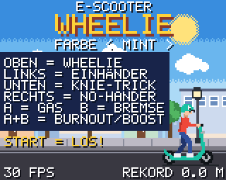
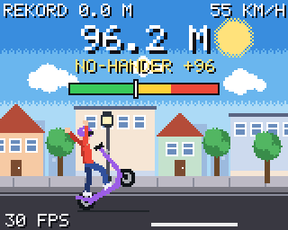
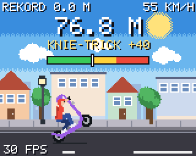
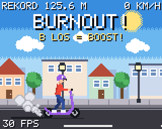
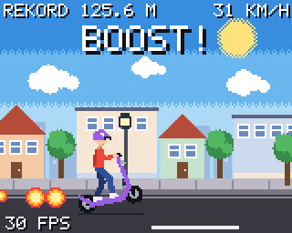

# E-Scooter Wheelie 🛴

Ein Wheelie-Spiel für den **Adafruit PyBadge** und **PyBadge LC**, komplett
selbst geschrieben in **CircuitPython**. Es besteht aus genau zwei Dateien:
[`code.py`](code.py) (das Spiel) und [`grafik.py`](grafik.py) (Bilder, Knöpfe, Ton).


| Menü | Wheelie | No-Hander | Knie-Trick |
|---|---|---|---|
|  |  |  |  |

| Burnout | Boost | Rekord | Sturz |
|---|---|---|---|
|  |  |  |  |

*(Bilder aus dem Simulator `tools/simulator.py`.)*

## Installation (geht auch nur mit dem Handy)

Du brauchst den PyBadge und ein **USB-Kabel, das Daten überträgt**.

1. **CircuitPython muss auf dem PyBadge sein** (nur beim ersten Mal, oder wenn
   vorher ein anderes Spiel als `.uf2` draufgespielt wurde):
   * Lade von <https://circuitpython.org/board/pybadge/> die `.uf2`-Datei herunter.
   * PyBadge anstecken, auf **ON** schalten und auf der Rückseite **zweimal
     schnell** den **Reset-Knopf** drücken. Es erscheint ein Laufwerk
     **BADGELCBOOT** (beim großen PyBadge: **PYBADGEBOOT**).
   * Die `.uf2`-Datei dorthin kopieren. Danach heißt das Laufwerk **CIRCUITPY**.
2. Kopiere **`code.py`** und **`grafik.py`** auf das Laufwerk **CIRCUITPY**
   (auf dem Samsung-Handy: *Eigene Dateien* → *USB-Speicher 1*).
   Alte Dateien mit dem gleichen Namen ersetzen.
3. Fertig, das Spiel startet von selbst. Ab jetzt bei jedem Einschalten.

Wichtig: Die Dateien müssen **genau** `code.py` und `grafik.py` heißen
(nicht `code (1).py`), und es müssen immer **beide** von der gleichen Version sein.

## Steuerung

| Knopf | Funktion |
|---|---|
| **START** | Spiel starten, im Spiel: Pause |
| **A** | Gas (bis 100 km/h), im Wheelie: Vorderrad höher |
| **B** | Bremse, im Wheelie: Vorderrad runter |
| **OBEN** | Wheelie: das Vorderrad geht hoch |
| **OBEN** nochmal | sauber landen, dann zählt der Wheelie |
| **LINKS** halten | Trick: Einhänder |
| **UNTEN** halten | Trick: in die Knie |
| **RECHTS** halten | Trick: No-Hander |
| **A + B** im Stand | Burnout. Nach 1 Sekunde **B loslassen** und A halten = **Boost** |
| **LINKS / RECHTS** im Menü | Scooter-Farbe wählen (12 Farben, auch Regenbogen) |
| **SELECT** im Menü | Ton an/aus (3 Sekunden halten: Rekorde löschen) |
| **SELECT** in der Pause | zurück ins Menü |

## So geht das Spiel

* Im **Menü** steht die Steuerung. Mit LINKS/RECHTS suchst du die Farbe aus
  (der Helm bekommt die gleiche Farbe), mit **START** geht es los.
* **A** gibt Gas. Der Scooter schafft **100 km/h**.
* **OBEN** reißt das Vorderrad hoch. Jetzt musst du selber balancieren:
  **A** = höher, **B** = tiefer. Die Anzeige oben hilft: grün = sicher,
  gelb = Gleichgewicht, rot = gleich kippst du um.
* Im Wheelie steht nur der **hintere Fuß** auf dem Scooter. Das vordere Bein schwingt
  frei mit (Gas wirft es nach hinten). Gehst du in die Knie, schlägt der Fuß
  auf dem Boden auf: Es staubt und kostet etwas Tempo.
* Mit nochmal **OBEN** landest du sauber. Nur dann zählt die Strecke für den
  **Rekord**. Kippst du nach hinten um, zählt der Wheelie nicht.
* **Tricks** (LINKS, UNTEN, RECHTS, auch zusammen) geben Trick-Punkte pro Meter.
  Beim No-Hander wirkt die Bremse nur schwach und der Scooter schwankt, das ist
  also riskant. In der Hocke fährt es sich ruhiger.
* **Burnout:** Im Stand A + B halten. Nach 1 Sekunde blinkt „B LOS = BOOST!“.
  Dann nur B loslassen: Der Scooter schießt in 2 Sekunden auf 100 km/h.
* Unten links steht, wie viele **Bilder pro Sekunde (FPS)** das Spiel schafft.
* Rekorde, Farbe und Ton bleiben gespeichert, auch nach dem Ausschalten.
* Die **LED** unter dem Display zeigt im Wheelie grün → gelb → rot.

## Einstellungen

Ganz oben in `code.py` steht ein Block **EINSTELLUNGEN**. Dort kannst du zum
Beispiel die Höchstgeschwindigkeit (`MAX_KMH`), die Kraft vom Boost
(`BOOST_ACCEL`) oder die Schwierigkeit (`GRAVITY`, `LIFT`, `DAMPING`) ändern.

## Wenn etwas nicht klappt

* Steht **FEHLER** auf dem Bildschirm: Kopiere `code.py` **und** `grafik.py`
  nochmal neu aufs Laufwerk. Hilft das nicht, mach ein Foto vom Bildschirm.
* Erscheint kein Laufwerk **CIRCUITPY** mehr, ist CircuitPython nicht (mehr)
  drauf: siehe Schritt 1 der Installation.

## Für Entwickler

Der PyBadge hat nur 192 KB Arbeitsspeicher, und CircuitPython muss jede Datei
beim Start erst übersetzen. Deshalb:

* **Alle Bilder sind vorgezeichnet.** `tools/bilder.py` zeichnet auf dem
  Computer den Scooter und den Fahrer in jedem Winkel, die Stadt, die Schrift
  usw. und hängt das Ergebnis als **Kommentar-Zeilen** ans Ende von
  `grafik.py`. Kommentare kosten beim Übersetzen keinen Speicher; `grafik.py`
  liest beim Start einfach seine eigenen letzten Zeilen (lauflängen-codiert)
  und füllt damit die Bitmaps. Das spart den ganzen Zeichen-Code auf dem Gerät
  und das Spiel startet in wenigen Sekunden.
* **Der Hintergrund steht still**, nur kleine Bildchen bewegen sich. Pro Bild
  müssen so nur etwa 2000 von 20480 Pixeln neu gemalt werden.
* **Während der Fahrt wird kein Speicher angefordert** (feste Listen, Texte
  nur bei Änderung), damit die Speicherbereinigung nicht dazwischenfunkt.

```sh
python -m venv venv
venv/bin/pip install adafruit-blinka-displayio pillow
venv/bin/python tools/bilder.py            # Bilder neu zeichnen -> grafik.py
venv/bin/python tools/simulator.py out     # Spiel am Computer durchspielen und prüfen
venv/bin/python tools/simulator.py out docs   # ... und die Bilder für diese Seite erneuern
```

`tools/simulator.py` lässt das echte `code.py` mit nachgebauten Knöpfen und
Bildschirm laufen, spielt alles durch (Menü, Farben, Wheelie, Tricks, Landen,
Sturz, Burnout, Boost, Pause, Speichern) und zählt, wie viele Pixel pro Bild
neu gemalt werden müssen.

## Handy-Version (Android)

Im Ordner [`handy/`](handy/README.md) liegt das Spiel als **Android-App** mit
Touch-Knöpfen, 3 Scootern, Tuning und schönerer Grafik. Die Physik ist die gleiche
wie hier. Dort steht auch, wie die App in den Google Play Store kommt.

## MakeCode-Arcade-Version

Im Ordner [`arcade/`](arcade/README.md) liegt eine frühere, andere Version des
Spiels als MakeCode-Arcade-Programm (`wheelie.uf2`). Sie wird nicht mehr
weiterentwickelt.
