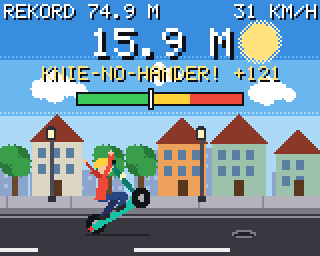

# E-Scooter Wheelie 🛴

Ein kleines Wheelie-Spiel für den **Adafruit PyBadge** (auch PyBadge LC),
geschrieben in CircuitPython.


| Start | Wheelie | Neuer Rekord | Gestürzt | Burnout | Knie-No-Hander |
|---|---|---|---|---|---|
|  |  |  |  |  |  |

*(Bilder aus dem Simulator, auf dem PyBadge sieht es genauso aus.)*

## Steuerung

| Knopf | Funktion |
|---|---|
| **OBEN** (Steuerkreuz) | Wheelie-Mode an – das Vorderrad geht hoch |
| **OBEN** nochmal | sauber landen – der Wheelie wird gezählt |
| **A** | Gas geben (bis 100 km/h), im Wheelie: Vorderrad höher |
| **B** | Bremsen, im Wheelie: Vorderrad runter |
| **A + B** gedrückt halten | Burnout! Danach B loslassen = Turbo-Start |
| **LINKS** halten | Trick: Einhänder |
| **RECHTS** halten | Trick: No-Hander (beide Hände hoch) |
| **RUNTER** halten | Trick: in die Knie |
| **START** | Pause (in der Pause: RUNTER = Bilder pro Sekunde anzeigen) |
| **SELECT** | Ton an/aus |
| **START 3 s halten** (im Startbildschirm) | Rekord löschen |

## So geht das Spiel

* Der Scooter rollt von allein mit 25 km/h. Mit **A** gibst du Gas, bis zu
  **100 km/h**.
* Drück **OBEN**: Du bist im **Wheelie-Mode** und das Vorderrad geht hoch.
* Jetzt musst du die **Balance halten**: Tipp **A** an, damit das Vorderrad
  oben bleibt. Kommst du zu weit hoch, drück **B**. Hältst du A die ganze
  Zeit, **kippst du nach hinten um**.
* Die **Anzeige oben** zeigt deinen Winkel: grün = sicher, gelb = Balance,
  rot = gleich kippst du um.
* Drück nochmal **OBEN**, dann landest du sauber. Die Wheelie-Strecke wird in
  **Metern** gezählt. Ist sie länger als dein bisheriger Rekord, gibt es einen
  **NEUEN REKORD!** Fällt das Vorderrad von selbst runter, zählt es auch.
* Wenn du nach hinten umkippst, **zählt der Wheelie nicht**.
* **Tricks im Wheelie:** Halt **LINKS** (Einhänder), **RECHTS** (No-Hander)
  oder **RUNTER** (in die Knie). Du kannst sie auch kombinieren, z. B.
  RUNTER + RECHTS = **Knie-No-Hander**. Tricks bringen **Trick-Punkte**:

  | Trick | Punkte pro Meter | Schwierigkeit |
  |---|---|---|
  | Einhänder | 1 | etwas weniger Kontrolle |
  | In die Knie | 1 | sogar ruhiger |
  | No-Hander | 3 | viel weniger Kontrolle, wackelt |
  | Knie-Einhänder | 4 | |
  | Knie-No-Hander | 8 | |

  Die Punkte zählen nur, wenn du sauber landest. Der beste Wert wird als
  **Trick-Rekord** gespeichert.
* **Burnout:** Halt **A und B** zusammen gedrückt. Der Scooter bremst ab, das
  Hinterrad dreht durch, es qualmt und gibt eine schwarze Reifenspur. Lässt du
  nach mindestens 1 Sekunde nur **B** los, gibt es einen **Turbo-Start**.
* Pass auf die **Gullydeckel** auf, die schütteln dich durch.
* Dein Rekord bleibt gespeichert, auch wenn du den PyBadge ausschaltest.
* Die LEDs unter dem Display leuchten im Wheelie grün → gelb → rot.

## Installation auf dem PyBadge

Du brauchst: den PyBadge und ein **Micro-USB-Kabel, das Daten überträgt**
(manche Kabel können nur laden, damit klappt es nicht).

### 1. CircuitPython installieren (nur einmal nötig)

Wenn beim Anstecken schon ein Laufwerk **CIRCUITPY** erscheint, kannst du
diesen Schritt überspringen.

1. Lade die CircuitPython-Datei (`.uf2`) für den PyBadge herunter:
   <https://circuitpython.org/board/pybadge/>
   (die neueste **stabile** Version, z. B. 10.x, Sprache „German“).
   Die Datei gilt auch für den PyBadge LC.
2. Steck den PyBadge per USB an den Computer und schalte ihn ein (Schalter **ON**).
3. Drück auf der **Rückseite** zweimal schnell hintereinander den
   **Reset-Knopf**. Die LED leuchtet grün und ein Laufwerk namens
   **PYBADGEBOOT** erscheint.
4. Zieh die `.uf2`-Datei auf das Laufwerk **PYBADGEBOOT**. Der PyBadge startet
   neu und es erscheint das Laufwerk **CIRCUITPY**.

### 2. Das Spiel kopieren

1. Lade die **zwei** Dateien [`code.py`](code.py) und [`grafik.py`](grafik.py)
   aus diesem Repository herunter (auf GitHub: Datei öffnen → Knopf
   „Download raw file“).
2. Kopiere **beide** auf das Laufwerk **CIRCUITPY** und ersetze dort die
   vorhandene `code.py`. Die Dateien müssen genau `code.py` und `grafik.py`
   heißen.
3. Fertig! Das Spiel startet nach ein paar Sekunden von selbst. Ab jetzt
   startet es jedes Mal, wenn du den PyBadge einschaltest, auch ohne
   Computer mit Akku.

Es werden **keine zusätzlichen Bibliotheken** gebraucht. Das Spiel ist auf
zwei Dateien aufgeteilt, weil der PyBadge nur wenig Arbeitsspeicher hat und
eine einzige große Datei nicht mehr laden konnte.

Wenn etwas schiefgeht, bleibt eine Fehlermeldung („FEHLER: …“) auf dem
Bildschirm stehen.

## Schwierigkeit anpassen

Oben in `code.py` gibt es einen Block **EINSTELLUNGEN**. Dort kannst du
z. B. ändern:

* `MAX_SPEED_KMH` – Höchstgeschwindigkeit mit Gas
* `CRUISE_KMH` – so schnell rollt der Scooter von allein
* `CRASH_DEG` – ab welchem Winkel man umkippt (größer = leichter)
* `GRAVITY` / `LIFT` – wie schnell das Vorderrad fällt bzw. hochgeht
* `DAMPING` – größer = gutmütiger und langsamer
* `BUMPS = False` – keine Gullydeckel

Datei speichern, und der PyBadge startet das Spiel automatisch neu.

## Probleme?

* **Bildschirm zeigt eine Fehlermeldung:** Prüfe, ob `code.py` **und**
  `grafik.py` auf CIRCUITPY liegen und ob CircuitPython 9 oder neuer
  installiert ist (Datei `boot_out.txt` auf CIRCUITPY zeigt die Version).
* **Kein Ton:** Mit SELECT einschalten. Manche PyBadge-LC-Versionen haben
  keinen Lautsprecher, das Spiel läuft dann einfach ohne Ton.
* **Laufwerk erscheint nicht:** anderes USB-Kabel probieren (Datenkabel!).

## Für Entwickler: Simulator

`tools/simulator.py` lässt das Spiel auf dem PC laufen (mit Adafruits
Blinka-displayio), steuert die Knöpfe automatisch, prüft die Spiellogik
und speichert Screenshots:

```sh
python -m venv venv
venv/bin/pip install adafruit-blinka-displayio pillow
venv/bin/python tools/simulator.py sim-output
```
