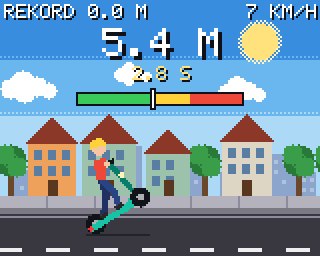
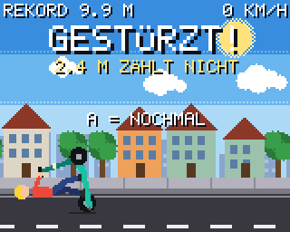

# E-Scooter Wheelie 🛴

Ein kleines Wheelie-Spiel für den **Adafruit PyBadge** (auch PyBadge LC),
geschrieben in CircuitPython.


| Start | Wheelie | Neuer Rekord | Gestürzt |
|---|---|---|---|
|  |  |  |  |

*(Bilder aus dem Simulator, auf dem PyBadge sieht es genauso aus.)*

## Steuerung

| Knopf | Funktion |
|---|---|
| **A** | Gas geben – zieht das Vorderrad hoch (Wheelie) |
| **B** | Bremsen – drückt das Vorderrad wieder runter |
| **START** | Pause |
| **SELECT** | Ton an/aus |
| **START 3 s halten** (im Startbildschirm) | Rekord löschen |

## So geht das Spiel

* Halt **A** gedrückt: Der Scooter fährt los und das Vorderrad geht hoch.
* Wenn du A die ganze Zeit hältst, **kippst du nach hinten um**. Tipp A also
  immer wieder kurz an, damit du in der Balance bleibst.
* Kommst du zu weit hoch, rettet dich **B** (Bremse): Das Vorderrad geht runter.
* Die **Anzeige oben** zeigt deinen Winkel: grün = sicher, gelb = Balance,
  rot = gleich kippst du um.
* Setzt das Vorderrad wieder auf, wird die Wheelie-Strecke in **Metern**
  gezählt. Ist sie länger als dein bisheriger Rekord, gibt es einen
  **NEUEN REKORD!**
* Wenn du nach hinten umkippst, **zählt der Wheelie nicht**.
* Pass auf die **Gullydeckel** auf, die schütteln dich durch.
* Dein Rekord bleibt gespeichert, auch wenn du den PyBadge ausschaltest.
* Die LEDs unter dem Display leuchten im Wheelie grün → gelb → rot.

## Installation auf dem PyBadge

Du brauchst: den PyBadge und ein **Micro-USB-Kabel, das Daten überträgt**
(manche Kabel können nur laden, damit klappt es nicht).

### 1. CircuitPython installieren (nur einmal nötig)

Wenn beim Anstecken schon ein Laufwerk **CIRCUITPY** erscheint, kannst du
diesen Schritt überspringen.

1. Lade die CircuitPython-Datei (`.uf2`) für den PyBadge herunter:
   <https://circuitpython.org/board/pybadge/>
   (die neueste **stabile** Version, z. B. 10.x, Sprache „German“).
   Die Datei gilt auch für den PyBadge LC.
2. Steck den PyBadge per USB an den Computer und schalte ihn ein (Schalter **ON**).
3. Drück auf der **Rückseite** zweimal schnell hintereinander den
   **Reset-Knopf**. Die LED leuchtet grün und ein Laufwerk namens
   **PYBADGEBOOT** erscheint.
4. Zieh die `.uf2`-Datei auf das Laufwerk **PYBADGEBOOT**. Der PyBadge startet
   neu und es erscheint das Laufwerk **CIRCUITPY**.

### 2. Das Spiel kopieren

1. Lade die Datei [`code.py`](code.py) aus diesem Repository herunter
   (auf GitHub: Datei öffnen → Knopf „Download raw file“).
2. Kopiere sie auf das Laufwerk **CIRCUITPY** und ersetze dort die
   vorhandene `code.py`.
3. Fertig! Das Spiel startet nach ein paar Sekunden von selbst. Ab jetzt
   startet es jedes Mal, wenn du den PyBadge einschaltest, auch ohne
   Computer mit Akku.

Es werden **keine zusätzlichen Bibliotheken** gebraucht. Alles steckt in
der einen Datei.

## Schwierigkeit anpassen

Oben in `code.py` gibt es einen Block **EINSTELLUNGEN**. Dort kannst du
z. B. ändern:

* `MAX_SPEED_KMH` – Höchstgeschwindigkeit
* `CRASH_DEG` – ab welchem Winkel man umkippt (größer = leichter)
* `GRAVITY` / `LIFT` – wie schnell das Vorderrad fällt bzw. hochgeht
* `DAMPING` – größer = gutmütiger und langsamer
* `BUMPS = False` – keine Gullydeckel

Datei speichern, und der PyBadge startet das Spiel automatisch neu.

## Probleme?

* **Bildschirm zeigt eine Fehlermeldung:** Prüfe, ob CircuitPython 9 oder
  neuer installiert ist (Datei `boot_out.txt` auf CIRCUITPY zeigt die Version).
* **Kein Ton:** Mit SELECT einschalten. Manche PyBadge-LC-Versionen haben
  keinen Lautsprecher, das Spiel läuft dann einfach ohne Ton.
* **Laufwerk erscheint nicht:** anderes USB-Kabel probieren (Datenkabel!).

## Für Entwickler: Simulator

`tools/simulator.py` lässt das Spiel auf dem PC laufen (mit Adafruits
Blinka-displayio), steuert die Knöpfe automatisch, prüft die Spiellogik
und speichert Screenshots:

```sh
python -m venv venv
venv/bin/pip install adafruit-blinka-displayio pillow
venv/bin/python tools/simulator.py sim-output
```
