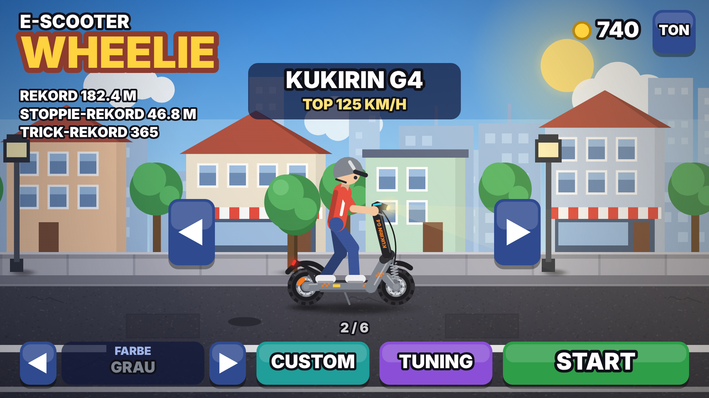
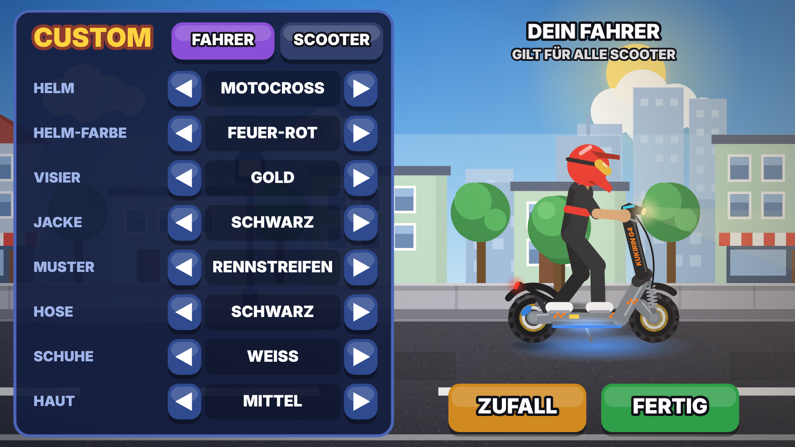
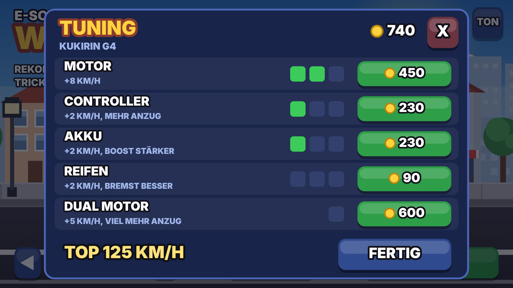
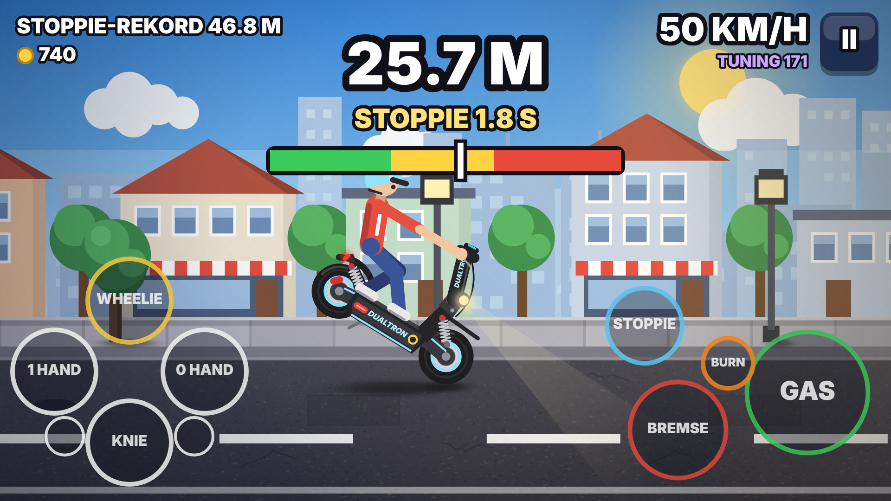
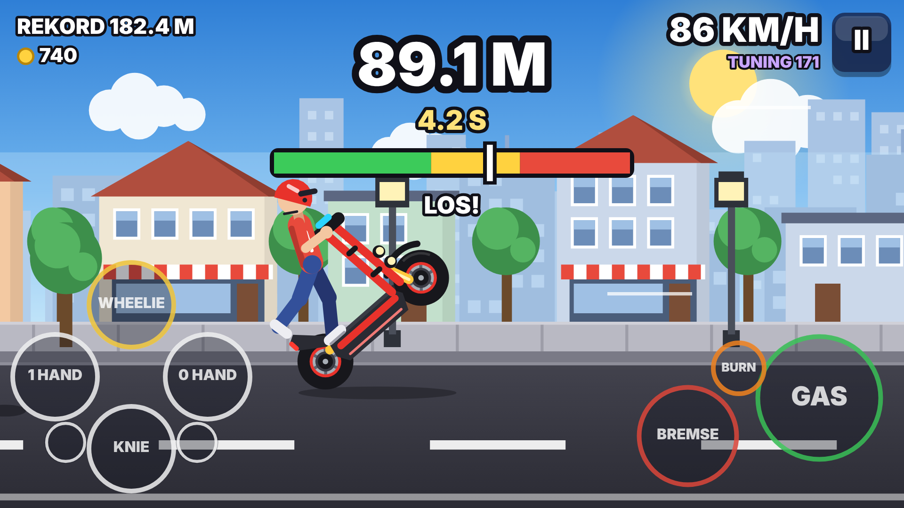

# E-Scooter Wheelie – Handy-Version 📱

Das gleiche Spiel wie auf dem PyBadge, aber für **Android-Handys** (und jeden
Browser). Die Physik ist 1:1 aus [`code.py`](../code.py) übernommen (gleicher
Wheelie, gleicher Burnout und Boost). Nur Tempo und Anzug hat jeder Scooter
seine eigenen. Neu dazu kommt der **Stoppie**.

| Menü | Custom | Tuning |
|---|---|---|
|  |  |  |

| Stoppie | Wheelie |
|---|---|
|  |  |

## Was ist neu?

* **Stoppie:** Das Heck geht hoch und der Scooter rollt nur noch auf dem
  Vorderrad. Ab 12 km/h **STOPPIE** drücken, dann balancieren:
  nur mit der Bremse: **BREMSE halten = Heck höher**, **BREMSE loslassen = Heck runter**. Gas braucht es nicht.
  Im Stoppie treibt der Motor nicht, der Scooter wird also langsamer, und wenn
  er fast steht, kommt das Heck von selbst runter. Nochmal **STOPPIE** = sanft
  landen. Zu weit hoch (über 58 Grad), und du fliegst über den Lenker.
  Tricks (1 Hand, 0 Hand, Knie) gehen auch, aber mit weniger Händen wirkt die
  Bremse schwächer. Der Stoppie hat einen eigenen Rekord.
* **6 Scooter**, jeder fährt anders (Werte ohne Tuning):

  | Scooter | Tempo | Anzug | Preis |
  |---|---|---|---|
  | Ninebot Max G3 | 80 km/h | 6,0 m/s² (wie das Original) | gratis |
  | Kukirin G4 | 105 km/h | 7,5 m/s² | 300 Münzen |
  | Segway GT2 | 112 km/h | 9,0 m/s², Dual-Motor ab Werk | 650 Münzen |
  | Kaabo Wolf Warrior 11 | 118 km/h | 9,5 m/s², Dual-Motor ab Werk | 950 Münzen |
  | Dualtron X Limited | 125 km/h | 10,5 m/s², Dual-Motor ab Werk | 1200 Münzen |
  | NAMI Burn-E 2 Max | 140 km/h | 11,5 m/s², Dual-Motor ab Werk | 2000 Münzen |
* **Münzen** gibt es für jeden sauber gelandeten Wheelie (2 pro Meter) und
  Stoppie (3 pro Meter), dazu kommen die Trick-Punkte.
* **Tuning** für jeden Scooter einzeln, 4 Teile mit je 3 Stufen und der Dual-Motor:

  | Teil | bringt pro Stufe |
  |---|---|
  | Motor | +5 (Ninebot), +8 (Kukirin), +10 (Segway), +11 (Kaabo), +12 (Dualtron), +13 km/h (NAMI) |
  | Controller | +2 km/h und mehr Anzug |
  | Akku | +2 km/h und stärkerer Boost |
  | Reifen | +2 km/h und bessere Bremse |
  | Dual-Motor (einmal) | +5 km/h und viel mehr Anzug (+2,5 m/s²). Beim Burnout rauchen dann beide Reifen. Segway, Kaabo, Dualtron und NAMI haben ihn schon. |

  Voll getunt: Ninebot 118, Kukirin 152, Segway 160, Kaabo 169, Dualtron 179,
  NAMI 197 km/h.
* **Scooter nach den echten Vorbildern gezeichnet** (nach Fotos): der Ninebot
  schlank mit roten Federn und Bremssätteln, der Kukirin kantig mit breiter
  schwarzer Lenkstange, Federbein vorn und orangen Details, der Dualtron mit
  Akku-Kasten, dicker Lenksäule, rundem Scheinwerfer und liegenden Federbeinen.
  Der Segway mit langem flachem Trittbrett und großer Titan-Gussform vorn, der
  Kaabo mit Motorrad-Gabel bis zum Lenker, Doppel-Scheinwerfer und
  Gepäckträger, der NAMI mit Gitterrohr-Rahmen und langer Gabel.
* **CUSTOM** (Knopf im Menü, alles gratis): links stellst du ein, rechts siehst
  du es gleich groß in der Vorschau. **ZUFALL** würfelt die ganze Seite neu.

  | Seite | Was man einstellen kann |
  |---|---|
  | **Fahrer** (gilt für alle Scooter) | Helm (offen, Integral, Motocross), Helm-Farbe (oder wie der Scooter), Visier/Brille, Jacke, Muster (Streifen, uni, doppelt, Rennstreifen in Helm-Farbe), Hose, Schuhe, Hautfarbe |
  | **Scooter** (jeder einzeln) | Farbe (14, auch Regenbogen), Felgen, Bremssättel, LED unter dem Trittbrett (leuchtet auch auf die Straße), Rauchfarbe beim Burnout (auch Regenbogen) |

  Am Anfang hat jeder Scooter seine echte Farbe (z.B. Ninebot schwarz, Kukirin
  grau, Segway titan, Dualtron schwarz mit eisblauen Details).
  Mit der Tastatur: Pfeile hoch/runter = Zeile, links/rechts = ändern,
  C = anderer Reiter, Enter = fertig.
* **Bessere Grafik:** alles wird scharf in der Auflösung vom Handy gezeichnet,
  der Hintergrund bewegt sich in mehreren Ebenen (Wolken, Hochhäuser, Häuser,
  Gehweg, Straße), die Räder drehen sich.
* **Realistischer** (nur fürs Auge und Ohr, die Fahr-Physik bleibt gleich):
  weicher Reifenrauch, Bremslicht und Scheinwerfer, Bremsscheiben, Asphalt mit
  Rissen, weiche Schatten und Sonnenlicht. Der Fahrer lehnt sich beim Gasgeben
  nach vorn und beim Bremsen nach hinten. Bei einer Vollbremsung quietschen die
  Reifen und es bleibt eine Bremsspur. Kurz vor dem Umkippen schleift das Heck
  und sprüht Funken (Warnung!). Der Motor klingt wie ein E-Motor (Summen und
  Sirren), dazu kommt Fahrtwind.
* **Touch-Knöpfe:** links WHEELIE / 1 HAND / 0 HAND / KNIE (die kleinen Kreise
  unten sind Knie + Hand zusammen), rechts GAS, BREMSE und STOPPIE.
  **BURN** drückt Gas und Bremse zusammen: im Stand halten, bis
  „BREMSE LOS = BOOST!" blinkt, dann den Finger **auf GAS schieben** (nicht loslassen).
* Am Computer geht auch die Tastatur: X = Gas, C = Bremse, S = Stoppie,
  Pfeile = Wheelie und Tricks, Enter = Start/Pause.

## Ausprobieren

**Im Browser:** `handy/www/index.html` öffnen (oder `npm start` im Ordner `handy`).

**Auf dem Handy:** Bei jedem Push baut GitHub die App automatisch
(`.github/workflows/android.yml`). Auf GitHub unter **Actions** → letzter Lauf →
**Artifacts** liegt `escooter-wheelie-apk`. Die `app-debug.apk` darin aufs Handy
laden und antippen („Aus unbekannten Quellen installieren" erlauben).

## In den Google Play Store

1. **Entwicklerkonto** auf <https://play.google.com/console> anlegen (einmalig
   25 US-Dollar, ab 18 Jahren, sonst über die Eltern).
2. **Schlüssel machen** (nur einmal, und **gut aufbewahren** – ohne ihn gibt es
   später keine Updates):

   ```sh
   keytool -genkeypair -v -keystore upload.jks -alias upload -keyalg RSA -keysize 2048 -validity 10000
   base64 -w0 upload.jks > upload.txt
   ```

   Auf GitHub unter *Settings → Secrets and variables → Actions* vier Secrets anlegen:
   `KEYSTORE_BASE64` (Inhalt von `upload.txt`), `KEYSTORE_PASSWORD`, `KEY_ALIAS`
   (`upload`) und `KEY_PASSWORD`. Die Schlüssel-Datei **nie** ins Repo legen.
3. Der nächste Lauf unter **Actions** liefert `escooter-wheelie-aab` mit der
   signierten `app-release.aab`. Diese Datei in der Play Console hochladen.
4. In der Play Console noch ausfüllen: Beschreibung, Icon
   ([`store/icon-512.png`](store/icon-512.png)), Screenshots (Ordner [`store/`](store/)),
   Altersfreigabe, Datenschutz (das Spiel sammelt keine Daten und braucht kein Internet).
5. Neue Privat-Konten müssen zuerst einen **geschlossenen Test mit 12 Testern
   über 14 Tage** machen, erst dann darf die App öffentlich werden.

Vor dem **ersten** Hochladen prüfen:

* **App-Kennung** `ch.escooter.wheelie` (in `capacitor.config.json` und
  `android/app/build.gradle`). Sie lässt sich nach dem ersten Hochladen nie mehr ändern.
* **Scooter-Namen:** „Ninebot", „Kukirin" und „Dualtron" sind geschützte Marken,
  und die Scooter sehen den echten Modellen ähnlich. Google kann Apps ablehnen,
  die fremde Markennamen benutzen. Die Namen (`name`) und die Schriftzüge auf
  den Scootern (`label`) stehen ganz oben in `www/game.js` bei `SCOOTERS` und
  sind in einer Minute geändert.
* Für jedes Update `versionCode` in `android/app/build.gradle` um 1 erhöhen.

## Für Entwickler

```
handy/
  www/index.html, www/game.js   das ganze Spiel (ohne Bibliotheken)
  android/                      Android-Projekt (Capacitor): Querformat, Vollbild
  tools/icon.js, tools/icons.py Icon und Store-Bilder aus dem Spiel erzeugen
  store/                        Icon 512 px und Screenshots für die Play Console
```

```sh
cd handy
npm install
npx cap sync android                       # www/ in die App kopieren
cd android && ./gradlew assembleDebug      # braucht Android SDK + Java 21
```

Die Einstellungen (Physik, Preise, Tuning) stehen ganz oben in `www/game.js`.
