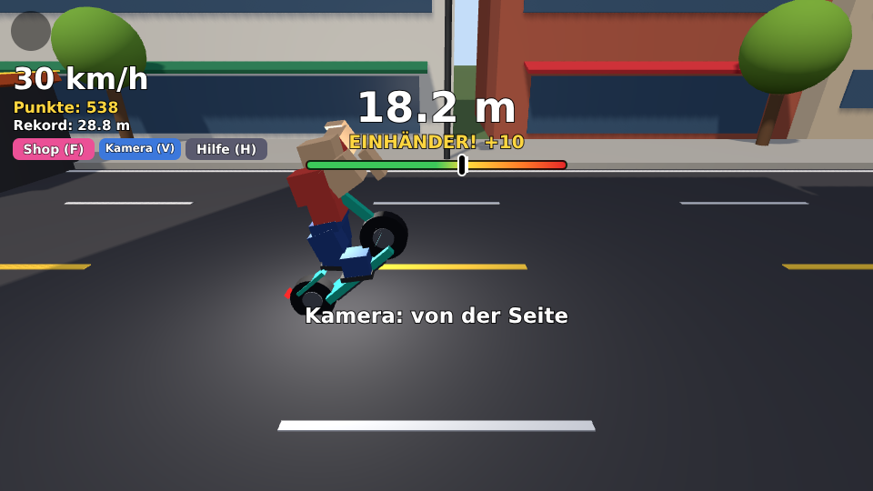
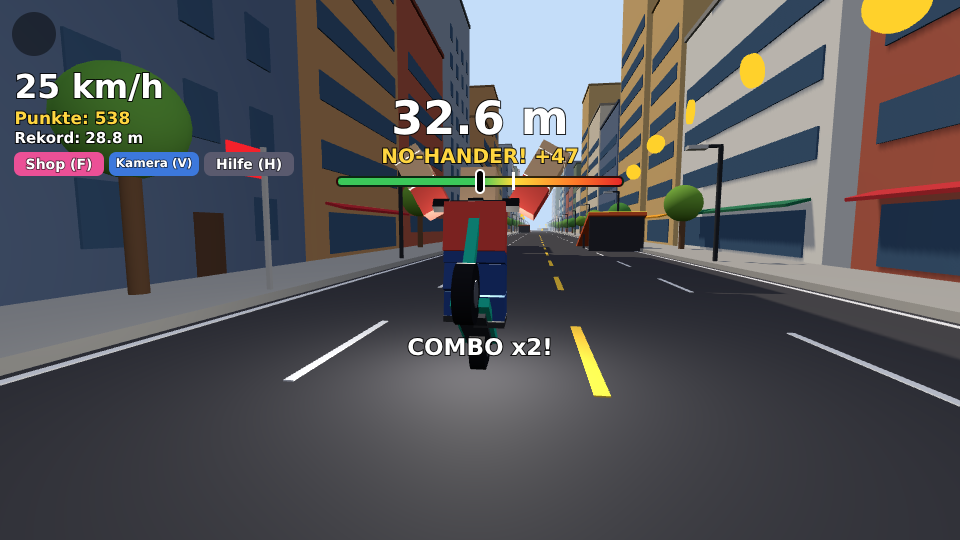
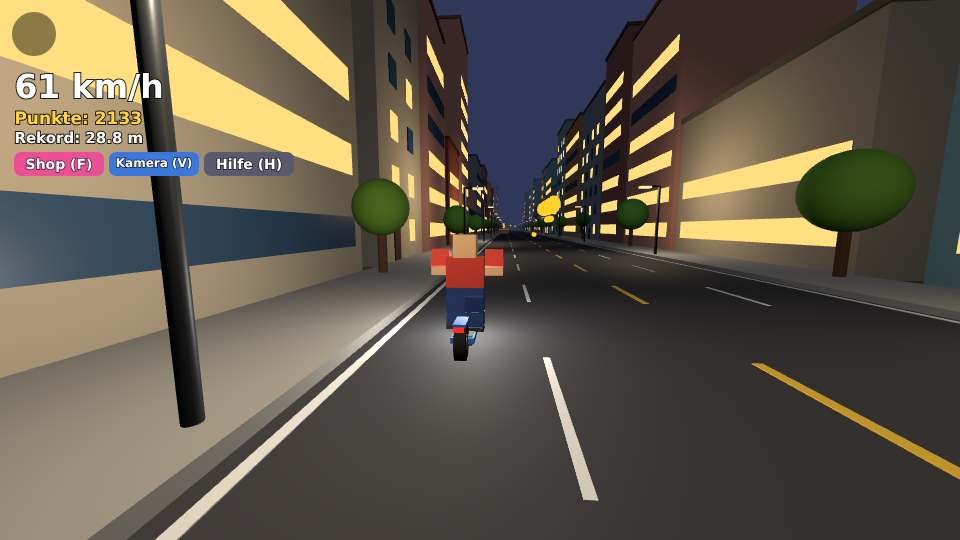
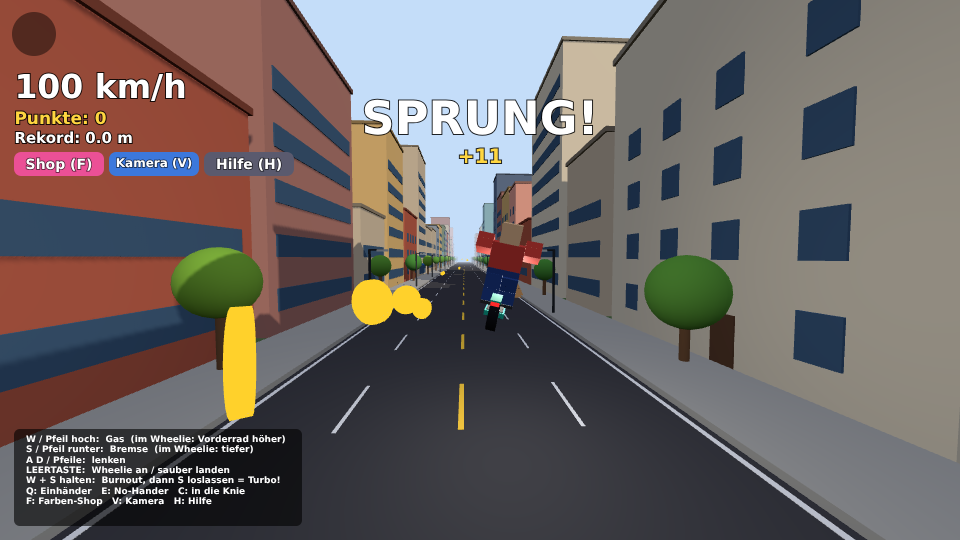
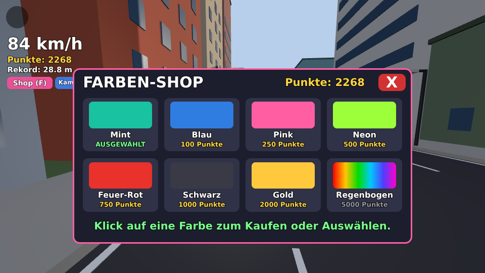
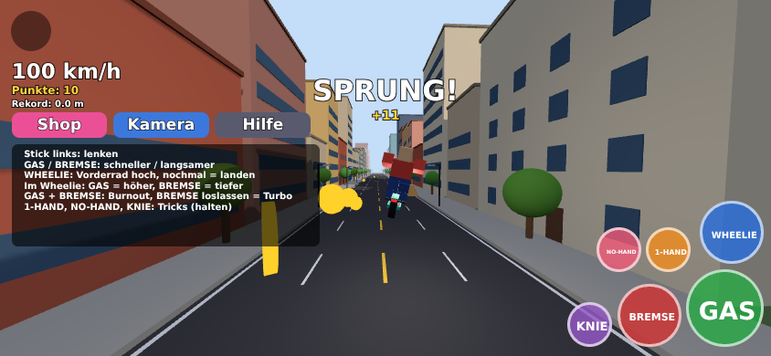

# E-Scooter Wheelie für Roblox 🛴

Das Wheelie-Spiel vom PyBadge als **3D-Spiel für Roblox**: eine lange Stadtstraße
mit Rampen, Münzen, Blitzern und Gullydeckeln. Man kann mit Freunden zusammen
fahren, am PC, auf dem Handy, auf dem Tablet und mit Controller.

| Wheelie mit Einhänder | No-Hander von vorne | Nacht |
|---|---|---|
|  |  |  |

| Fahren | Farben-Shop | Handy |
|---|---|---|
|  |  |  |

*Die Bilder sind eine Vorschau aus der Test-Umgebung (siehe unten). In Roblox
fährt deine eigene Figur mit, und Licht und Schatten sehen etwas anders aus.*

## So startest du das Spiel

Du brauchst einen Computer (Windows oder Mac) mit **Roblox Studio**. Das gibt
es gratis auf <https://create.roblox.com>.

1. Lade die Datei [`EScooterWheelie.rbxlx`](EScooterWheelie.rbxlx) herunter
   (auf GitHub: Datei öffnen, dann „Download raw file“).
2. Öffne sie mit Doppelklick, dann geht Roblox Studio auf.
   (Oder in Studio: **File → Open from File…**)
3. Drück oben auf **Play** ▶. Los geht's!

## Mit Freunden und auf dem Handy spielen

1. In Roblox Studio: **File → Publish to Roblox**, einen Namen eingeben
   (z. B. „E-Scooter Wheelie“) und auf **Create** klicken.
2. Auf <https://create.roblox.com> bei deinem Spiel einstellen, dass es
   **öffentlich** ist (Roblox stellt vorher ein paar Fragen zum Inhalt).
   Dann finden es deine Freunde in der Roblox-App, auch auf dem Handy.
3. Punkte, Rekorde und gekaufte Farben werden im veröffentlichten Spiel
   automatisch gespeichert. Damit das auch beim Testen in Studio klappt:
   **Home → Game Settings → Security → Enable Studio Access to API Services**
   einschalten.

## Steuerung

| PC | Handy / Tablet | Controller | Funktion |
|---|---|---|---|
| **W** / ↑ | **GAS** | RT | Gas (bis 100 km/h), im Wheelie: Vorderrad höher |
| **S** / ↓ | **BREMSE** | LT | Bremse, im Wheelie: Vorderrad runter |
| **A D** / ← → | Stick links | linker Stick | lenken |
| **Leertaste** | **WHEELIE** | A | Wheelie-Mode an, nochmal = sauber landen |
| **W + S** halten | GAS + BREMSE | RT + LT | Burnout! Dann Bremse loslassen = Turbo-Start |
| **Q** halten | **1-HAND** | X | Trick: Einhänder |
| **E** halten | **NO-HAND** | Y | Trick: No-Hander |
| **C** halten | **KNIE** | B | Trick: in die Knie |
| **F** | Shop | Steuerkreuz hoch | Farben-Shop |
| **V** | Kamera | Steuerkreuz runter | Kamera: hinten, von der Seite (wie auf dem PyBadge), von vorne |
| **H** | Hilfe | | Hilfe ein/aus |

## So geht das Spiel

* Der Scooter rollt von allein mit 25 km/h. Mit Gas geht es bis 100 km/h.
* Drück die **Wheelie-Taste** und halte dann mit Gas (höher) und Bremse
  (tiefer) die Balance. Die Anzeige oben hilft: grün = sicher,
  gelb = Balance, rot = gleich kippst du um.
* Mit nochmal Wheelie-Taste landest du sauber, dann zählt der Wheelie:
  1 Punkt pro Meter. Kippst du nach hinten um, zählt er nicht.
* **Rekord-Fahne:** Im Wheelie steht rechts am Straßenrand eine rote Fahne.
  Schaffst du es bis dorthin, ist es ein neuer Rekord.
* **Tricks** geben Trick-Punkte. Verschiedene Tricks im gleichen Wheelie oder
  Sprung ergeben eine **Combo** (x2, x3 …).
* **Rampen** (braun = klein, orange = groß) lassen dich springen. In der Luft
  gibt es Sprung-Punkte, mit Tricks mehr. Aber: Wer mit No-Hander landet, stürzt.
* **Münzen** geben je 10 Punkte. Die hohen erwischst du nur im Wheelie oder im
  Sprung.
* **Blitzer:** Fährst du mit 60 km/h oder mehr vorbei, wirst du geblitzt und
  bekommst so viele Punkte, wie du km/h draufhattest.
* **Gullydeckel** schütteln dich im Wheelie durch.
* Die Straße ist 1,5 km lang. Am Ziel gibt es 100 Punkte, dann geht es wieder
  von vorne los (die Münzen sind dann wieder da).
* **Tag und Nacht:** Die Sonne geht unter, die Fenster und Laternen gehen an.
* **Farben-Shop:** Alle Punkte landen auf deinem Konto:

  | Mint | Blau | Pink | Neon | Feuer-Rot | Schwarz | Gold | Regenbogen |
  |---|---|---|---|---|---|---|---|
  | gratis | 100 | 250 | 500 | 750 | 1000 | 2000 | 5000 |

* In der Bestenliste (oben rechts) stehen die Punkte und der Wheelie-Rekord
  von allen auf dem Server.

## Einstellungen

In Roblox Studio unter **ReplicatedStorage → Wheelie → Einstellungen** stehen
die Werte zum Verändern, genau wie beim PyBadge: Tempo, Schwierigkeit des
Wheelies, Sprunghöhe, Punkte, Länge der Straße, Länge eines Tages.
Mit einer anderen Zahl bei `SEED` bekommst du eine andere Strecke.

Gut zu wissen: Die Hände am Lenker und die Trick-Bewegungen gibt es für die
normalen Roblox-Figuren (R15). Mit alten R6-Figuren zählen die Tricks auch,
nur die Arme bewegen sich nicht.

## Für Entwickler

Der Quelltext liegt in [`src/`](src/) und wird mit [Rojo](https://rojo.space)
zu einer Roblox-Datei zusammengebaut:

| Datei | Inhalt |
|---|---|
| `src/shared/Einstellungen.luau` | alle Einstellungen |
| `src/shared/Physik.luau` | Wheelie-Physik (wie auf dem PyBadge) |
| `src/shared/Farben.luau` | Farben und Preise für den Shop |
| `src/server/init.server.luau` | Server: Spielstand speichern, Scooter verteilen, Shop |
| `src/server/Welt.luau` | baut die Straße mit allem drum und dran |
| `src/server/Scooter.luau` | baut den E-Scooter |
| `src/client/init.client.luau` | Fahren, Wheelie, Tricks, Sprünge, Kamera, Tag und Nacht |
| `src/client/HUD.luau` | Anzeige, Handy-Knöpfe, Farben-Shop |
| `src/client/Posen.luau` | Körperhaltung der Fahrer |
| `src/client/Toene.luau` | Töne |

```sh
./build.sh            # baut EScooterWheelie.rbxlx (braucht Rojo)
rojo serve            # live in Roblox Studio bearbeiten (Rojo-Plugin)
tools/test.sh         # testet das Spiel ohne Roblox
tools/test.sh bilder  # dazu die Vorschaubilder
```

`tools/test.sh` führt Server und Spieler in einem nachgebauten Roblox aus
(`tools/mock.luau`). Jede Eigenschaft, Methode und jedes Enum wird dabei gegen
die echte Roblox-API-Liste geprüft. Dann fährt ein Bot mit PC- und
Handy-Steuerung: Vollgas, Rampen, Wheelies mit Balance, Tricks und Combo,
Sturz, Burnout, eine ganze Runde, Shop, Nacht, Respawn und Speichern.
Das ersetzt keinen Test im echten Roblox, findet aber Tippfehler und
Logikfehler, bevor man Studio aufmacht.
